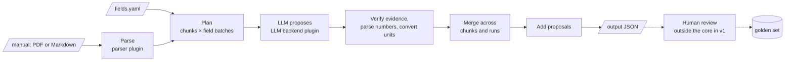

# citefield — Design Doc

Version: v1.0.0
Date: Oct 30, 2026
Author: Alessio Chessa

This doc describes the current design. The reasons behind each decision are in the [architecture decision records](adr/README.md).

## Overview

citefield is an open-source Python library and CLI that reads a technical manual, extracts a configured set of metadata fields with verifiable evidence, proposes new fields, and emits JSON that a human can validate value by value.

**Goals**

- Extract the fields defined in a YAML config into JSON, each value backed by a quote and a page.
- Propose fields outside the config, capped and checked against it for duplicates.
- Expose per-signal confidence scores; the client decides how to interpret them.
- Make every result reviewable, and every review reusable as evaluation data.

**Non-goals for v1:** a review UI, diagrams or scanned pages (no vision, no OCR), filling values from the model's world knowledge, and storing results in a database.

**Principles**

1. The LLM only proposes. Code verifies, humans decide.
2. No evidence, no value: every value cites a verbatim quote or table cell and its page.
3. Deterministic where possible: unit conversion, evidence checks and merging are code, not prompts.
4. Pluggable at the edges: the LLM backend and the document parser.
5. Never silently overwrite human review work.

Decision record: [ADR-0003](adr/0003-require-evidence-for-every-value-verified-in-code.md).

## Architecture

A run is a straight pipeline: parse the document, plan the calls, let the LLM propose, then verify, merge and add proposals in code. The parser and the LLM backend are the two plug-in points; the module layout is under Public API and CLI.



Only one stage calls the LLM for extraction; everything after it is deterministic code, and the dashed review step happens outside the core in v1.

## Document parsing

The default parser is **pdfplumber**, installed with the core package; **docling** is the recommended optional upgrade. pdfplumber keeps `pip install citefield` light and permissive, and handles tables in born-digital PDFs well. docling gives better layout and table recovery and covers DOCX, HTML and PPTX for the roadmap, but it pulls in PyTorch and model weights, too heavy for a default.

| Parser     | License                                   | Install weight           | Tables                    | Formats                   | Role in citefield                       |
| ---------- | ----------------------------------------- | ------------------------ | ------------------------- | ------------------------- | --------------------------------------- |
| pdfplumber | MIT                                       | Light (pdfminer.six)     | Good on born-digital PDFs | PDF                       | Default, core install                   |
| docling    | MIT code; models under their own licenses | Heavy (PyTorch + models) | Best layout and tables    | PDF, DOCX, HTML, PPTX, MD | Extra `citefield[docling]`, recommended |
| pypdf      | BSD                                       | Lightest                 | Weak                      | PDF                       | Extra `citefield[pypdf]`                |
| PyMuPDF    | AGPL-3.0 or commercial                    | Light                    | Good                      | PDF and more              | Extra `citefield[pymupdf]`, opt-in only |

Markdown needs no parser: a built-in reader splits it by headings.

Decision record: [ADR-0004](adr/0004-pdfplumber-as-default-parser-with-optional-extras.md).

**Parser interface.** Every parser implements one protocol and registers through the `citefield.parsers` entry point, so third-party parsers plug in without changes to the core.

```python
class DocumentParser(Protocol):
    name: str
    def supports(self, path: Path) -> bool: ...
    def parse(self, path: Path) -> ParsedDocument: ...
```

**Internal document model.** Parsers return the same structure, so everything downstream is parser-agnostic.

```python
class ParsedDocument(BaseModel):
    path: str
    sha256: str
    parser: ParserInfo            # name + version, recorded in the output
    units: list[Unit]             # pages for PDF, heading sections for Markdown

class Unit(BaseModel):
    id: str
    locator: Locator              # page=12, or section="3.2 Technical data"
    text: str
    tables: list[Table]
    low_text: bool                # little extractable text: likely scanned or visual

class Table(BaseModel):
    id: str                       # e.g. "t3"
    locator: Locator
    header: list[list[str]]
    rows: list[list[str]]
```

Tables reach the LLM as Markdown tables tagged with their id and page, so evidence can cite a table cell. A unit with fewer than 200 non-whitespace characters is low-text: blank, scanned, or mostly visual such as figures, decals and chapter dividers. Low-text units are listed in the output warnings, so the reviewer knows what was skipped.

Pages are numbered by their 1-based position in the PDF, not by the label printed on them: in a manual whose page 28 is printed as "0002-6", evidence cites page 28.

## Configuration

One YAML file holds the field schema and the run settings; any setting can be overridden from the API or CLI. Only `name` and `description` are required per field, so a quick config stays quick.

```yaml
schema_version: 1

units: # extra unit definitions for pint
  - "bottle = [count]"
  - "bph = bottle / hour"

fields:
  - name: production_speed
    description: >
      Nominal production speed of the machine in bottles per hour.
      Not necessarily stated in the manual.
    type: number # number | integer | string | boolean | enum | date
    unit: bph # canonical unit; values are converted in code
    aliases:
      [output, throughput, "velocità di produzione", "Ausbringung", "Leistung"]
    examples: ["24,000 bph", "400 bottles/min"]

  - name: power_supply_voltage
    description: Mains supply voltage.
    type: number
    unit: V

  - name: machine_category
    description: Type of machine described by the manual.
    type: enum
    values: [filler, capper, labeller, palletizer, other]

settings:
  parser: pdfplumber
  llm:
    model: provider/model-name
    temperature: 0 # null: not sent, for models that don't accept it
    reasoning_effort: null # none | minimal | low | medium | high | xhigh; null: provider default
    provider: null # OpenRouter provider routing, e.g. {order: [deepinfra/bf16], allow_fallbacks: false}
    max_retries: 2
  chunking:
    max_input_tokens: auto # auto = model context window minus prompt and output reserve
    overlap_units: 1 # pages of overlap between chunks
  extraction:
    field_batch_size: 30 # B: fields per LLM call
    n_runs: 1 # >1 enables the run_agreement signal
    number_locale: auto # auto | en | it | de
  proposals:
    enabled: true
    max_per_document: 10 # N
  verification:
    fuzzy_min_ratio: 0.85 # below it, a value gets an evidence_not_verified warning
    page_window: 1 # also search pages ±1 for the quote
```

**Validation rules.** Field names are unique snake_case. Enum fields need `values`, and only enum fields may have them. Only number and integer fields may have a `unit`, and every `unit` must resolve in the pint registry, including custom `units`. The config is validated with pydantic before any LLM call (`citefield validate-config`).

**LLM routing.** `provider` is passed to OpenRouter as its provider-routing preferences, merged over `require_parameters: true`, and is allowed only for `openrouter/` models; pin an endpoint by its tag with `allow_fallbacks: false` to make runs comparable. `reasoning_effort` goes to LiteLLM, which maps it for each provider. Decision record: [ADR-0018](adr/0018-add-openrouter-provider-routing-and-reasoning-effort-settings.md).

**Hashes.** The output records a `schema_hash` over the normalized `fields` and `units`, and a `settings_hash` over settings that change results (parser, model, temperature, reasoning effort and provider routing when set, chunking, extraction). Re-extraction and evaluation use them to tell what changed.

## Extraction

A run makes `chunks × field batches × n_runs` extraction calls, plus one proposal call per chunk. With a document that fits the context window, 30 fields and default settings, that is 2 calls.

**1. Plan.** Count the document's tokens. `max_input_tokens: auto` is the model's context window minus 8,192 tokens kept for the answer; when the backend doesn't know the context window, it assumes 128k. If the prompt fits, the document goes in one chunk; otherwise it is split at unit boundaries (pages) with `overlap_units` of overlap, so tables are not cut in half. Fields are split into batches of `field_batch_size` (B ≤ N). `citefield extract --dry-run` prints the plan and a token estimate without calling the LLM.

**2. Prompt.** Each call carries the rules, the batch's field definitions and the chunk text with explicit markers (`[[page 12]]`, `[[table t3 · page 12]]`). The rules: cite evidence for every value, copy the raw value and unit verbatim, never use outside knowledge, return nothing for a field that is not in the text. Prompt templates are versioned and the version is recorded in the output.

**3. Structured response.** The model answers through the backend's JSON-schema or tool-call mode; pydantic validates it. Invalid output is retried up to `max_retries`; a batch that still fails marks its fields `error` with the message in the field's `error`, and the other batches are unaffected. API errors are retried by the backend, not again by the core. Per field, the model returns a list of candidates:

- `raw_value` and `raw_unit`, verbatim
- `context`: what the value applies to (model, format, condition), if stated
- `evidence`: a quote with its page, or a table cell as table id + row label + column label + cell text
- `model_confidence`: the model's own 0–1 estimate

**4. Post-process in code.** A candidate without evidence is dropped. Every other candidate is kept and its evidence verified (see signals), so a value whose quote can't be found stays visible to the reviewer, with its low `evidence_match` and an `evidence_not_verified` warning when the best match is below `fuzzy_min_ratio`. An enum value is matched to the allowed `values` case-insensitively; a value outside them keeps `value: null` and gets an `enum_value_unknown` warning. Parse numbers with `number_locale`; an ambiguous form such as "24.000" with `auto` gets a warning rather than a silent choice. Convert units with pint: a converted value gets status `derived` and a human-readable `derivation`, an unconverted one `found`. A value without a unit for a field that has one keeps `value: null` and `unit_resolved: false`; the unit is never assumed.

**5. Merge across chunks and runs.** Candidates are grouped by normalized value and normalized context.

- Same value, same context: one value, all evidence kept.
- Different values, different contexts: a list (e.g. one speed per bottle format). Not a conflict.
- Different values, same or missing context: field status `conflict`, all values kept for the reviewer. Never resolved silently.

**Field and value statuses.** Field: `found`, `not_found`, `conflict`, `error`. Value: `found` (stated in the text) or `derived` (converted in code).

**Proposals.** A separate call per chunk, after extraction, sees the configured field names and aliases and is asked only for fields outside them. Each proposal is a ready-to-paste field definition plus values, under the same evidence rules. In code, a proposal whose name or aliases are close to an existing field is kept but marked `possible_duplicate_of`. Proposals are ranked by citation count and model confidence, and the top `max_per_document` are kept.

## Evidence and confidence signals

Each value carries a set of named signals and no aggregate score or band: clients decide how to weigh them. Signals are an object keyed by name, so clients read them by name rather than by position.

| Signal             | Type and range | Null when                    | What it measures                                                                                                                                                                                                       |
| ------------------ | -------------- | ---------------------------- | ---------------------------------------------------------------------------------------------------------------------------------------------------------------------------------------------------------------------- |
| `evidence_match`   | float 0–1      | never (0 if nothing matched) | Best match of the cited evidence against the cited page ±`page_window`, after folding case, ligatures, quotes and dashes and removing whitespace and hyphenation. Reported as is, without a threshold. For table evidence: share of row label, column label and cell text found on the page. |
| `citation_count`   | integer ≥ 1    | never                        | Independent citations (distinct pages or tables) that support the same value after merging.                                                                                                                            |
| `run_agreement`    | float 0–1      | `n_runs` = 1                 | Share of runs that produced this value.                                                                                                                                                                                |
| `model_confidence` | float 0–1      | backend gives none           | The model's own estimate. Uncalibrated; documented as such.                                                                                                                                                            |
| `unit_resolved`    | boolean        | field has no unit            | Whether the raw unit was recognized and converted to the field's canonical unit.                                                                                                                                       |

Whether a value is stated or converted is not a signal: it is the value's `status` (`found` or `derived`).

**Contract.** Signal names and semantics are part of the public API. Adding a signal is a minor version; renaming, removing or changing a range is a major version. The output's `output_schema_version` lets clients check what they read.

Decision records: [ADR-0006](adr/0006-named-confidence-signals-without-aggregate-score.md) (named signals), [ADR-0013](adr/0013-report-evidence-match-as-the-raw-best-score.md) (`evidence_match` without a threshold).

**Known limit.** `evidence_match` depends heavily on the parser's text quality. It is best-effort in v1, and the evaluation can compare parsers on the same documents.

## Output JSON

One JSON file per document, defined by pydantic models; the repo publishes the generated JSON Schema. Every value has empty review fields from the start, so any future UI only fills them in.

```json
{
  "citefield_version": "0.1.0",
  "output_schema_version": 1,
  "document": {
    "document_id": "filler-x200",
    "path": "manuals/filler-x200.pdf",
    "sha256": "…",
    "units": 214,
    "parser": { "name": "pdfplumber", "version": "…" }
  },
  "run": {
    "run_id": "…",
    "started_at": "2026-10-30T18:30:00+01:00",
    "model": "provider/model-name",
    "prompt_version": "extract-v1",
    "schema_hash": "…",
    "settings_hash": "…",
    "n_runs": 1,
    "chunks": 1,
    "llm_calls": 2,
    "tokens": { "input": 0, "output": 0 }
  },
  "fields": [
    {
      "name": "production_speed",
      "status": "found",
      "values": [
        {
          "value_id": "…",
          "status": "derived",
          "raw_value": "400",
          "raw_unit": "bottles/min",
          "value": 24000,
          "unit": "bph",
          "derivation": "400 bottles/min × 60 min/h = 24000 bph",
          "context": "0.5 L PET",
          "evidence": [
            {
              "kind": "quote",
              "page": 12,
              "quote": "Output: 400 bottles/min (0.5 L PET)"
            }
          ],
          "signals": {
            "evidence_match": 0.97,
            "citation_count": 1,
            "run_agreement": null,
            "model_confidence": 0.9,
            "unit_resolved": true
          },
          "review": {
            "status": "pending",
            "reviewed_value": null,
            "equivalents": [],
            "reviewer": null,
            "reviewed_at": null,
            "note": null,
            "carried_from": null,
            "previous": null
          }
        }
      ],
      "review": { "status": "pending", "reviewer": null, "reviewed_at": null, "note": null }
    },
    {
      "name": "power_supply_voltage",
      "status": "not_found",
      "values": [],
      "review": { "status": "confirmed_absent", "reviewer": "…", "reviewed_at": "…", "note": null }
    }
  ],
  "proposals": [
    {
      "definition": {
        "name": "compressed_air_pressure",
        "description": "Required compressed air supply pressure.",
        "type": "number",
        "unit": "bar",
        "aliases": ["pressione aria"]
      },
      "possible_duplicate_of": null,
      "values": ["… same shape as field values …"]
    }
  ],
  "warnings": [
    { "code": "low_text_units", "units": [3, 47, 48] },
    { "code": "ambiguous_number", "field": "production_speed", "raw": "24.000" }
  ]
}
```

**Stable ids.** `value_id` is a hash of field name, normalized value and normalized context, so re-runs can match values across runs. `document_id` defaults to the file name and can be set by the user to link revisions of the same manual.

## Review, re-extraction and evaluation

Human decisions are written into the output file, survive re-extraction, and become the evaluation set. The pattern follows Luca Bianchi's workshop (see Acknowledgements). Decision record: [ADR-0007](adr/0007-store-reviews-in-the-output-file.md).

**Review.** A value's `review.status` is `pending`, `accepted`, `edited` (with `reviewed_value`), `rejected` or `added` (a value the reviewer found and the LLM missed). An accepted, edited or added value can list `equivalents`: other forms of the same fact that the evaluation also accepts, such as the same size in another unit the manual states. An added value needs evidence like any other, verified against the document's pages when `apply_review` is given them (`evidence_match` is 0 otherwise); its `model_confidence` is null. Each field also has a `review` whose status is `pending` or `confirmed_absent`: the reviewer confirms that the manual doesn't state the field, which is allowed only when all its values are rejected. The core ships `apply_review(output, decisions)` to write decisions in, keyed by field name and `value_id`; the UI that collects them is out of scope for v1, and `scripts/review.py` writes a YAML decisions template to fill in by hand. Decision record: [ADR-0014](adr/0014-record-field-level-review-in-the-output.md).

**Re-extraction.** When a document is re-run (new config, model, parser or manual revision) with `--previous`, each new value is compared with the reviewed values of the same `document_id`:

| Case                  | Condition                                                               | Result                                                         |
| --------------------- | ----------------------------------------------------------------------- | -------------------------------------------------------------- |
| Reconfirmation        | Same field, normalized value and context as an accepted or edited value | Review carried over; `carried_from` = previous run id          |
| Novelty               | No reviewed value for that field and context                            | `pending`                                                      |
| Conflict              | A reviewed value exists with a different value                          | `pending`; `previous` holds the old reviewed value             |
| Re-proposed rejection | Same as a rejected value                                                | Stays `rejected`, so nobody reviews the same wrong value twice |

Values the reviewer `added` are kept even if the new run misses them. Known trade-off: reconfirmation assumes the first reviewer was right; audit sampling of carried-over values is planned for later.

**Evaluation.** The golden set is every reviewed value across a folder of outputs: accepted, edited and added values are positives; rejected values, and the original of an edited value, are negatives; fields reviewed as absent count for `not_found`. `citefield eval` re-runs extraction on those documents with the current config, model and parser, finding each manual at its recorded path or by SHA-256 in `--documents`. With `--predictions`, it scores outputs already saved by `citefield extract` instead, so a model comparison runs extraction once per model. Decision record: [ADR-0016](adr/0016-let-eval-score-saved-outputs.md).

A prediction matches a golden value on field and a match key that is looser than the one behind `value_id`: text casefolded, without whitespace, ®, ™ or ©, with straight quotes and no trailing footnote asterisks, and for string fields with the raw unit appended (`18.92lb` matches `18.92` with unit `lb`). It also matches any of the value's `equivalents`, and several predicted forms of one golden value count once. A form is equivalent when it states the same fact: other notation, a unit or conversion the manual states, trademark or marketing words, footnote marks, or extra detail of that fact from the same passage. Context is not part of the match, and matches whose contexts differ are counted as `context_mismatches`. A field counts in a document only when it is fully reviewed: no pending values, and at least one reviewed value or confirmed absent. Then every prediction that matches no positive is a false positive, and those that match no negative either are listed as unjudged, ready to review into the golden set. Decision record: [ADR-0017](adr/0017-match-eval-values-loosely-and-accept-reviewed-equivalents.md). The report gives, per field and in total:

- precision and recall of values
- accuracy of `not_found`: the share of confirmed-absent fields predicted with no values
- for `evidence_match` and `model_confidence`, precision by signal range (below 0.5, 0.5 to 0.85, 0.85 and above, null), to show which signals are worth trusting

Two exclusions keep it honest: carried-over values count once (by `document_id` and `value_id`), and any value that appears in a field's `examples` is left out, otherwise the eval measures whether the model copies the prompt. `--json` writes the report with each prediction's model, prompt version, settings hash and tokens. Not yet built: accuracy by range for the other signals, and `--parser` to compare parsers on the same golden set.

The golden set for the corpus lives in `corpus/golden/<config>/`, one reviewed output per manual next to its YAML decisions, scored with the config of the same name in `examples/`.

## Public API and CLI

The library is the product; the CLI is a thin layer over it. v1 is synchronous, with a `--workers` option in the CLI for folders.

```python
import citefield

config = citefield.load_config("fields.yaml")
extractor = citefield.Extractor(config)            # parser and LLM backend from settings

result = extractor.extract("manuals/filler-x200.pdf")   # ExtractionResult (pydantic)
result.to_json("out/filler-x200.json")

updated = extractor.reextract("manuals/filler-x200-rev2.pdf",
                              previous="out/filler-x200.json")

reviewed = citefield.apply_review("out/filler-x200.json", decisions)
report = citefield.evaluate("golden/", config=config)  # or predictions="out/"
```

The LLM backend is a protocol like the parser. The default adapter uses LiteLLM, which covers cloud APIs and local servers (Ollama, vLLM) behind one interface. Backends register through the `citefield.llm_backends` entry point. Decision record: [ADR-0005](adr/0005-litellm-as-default-llm-backend.md).

```python
class LLMBackend(Protocol):
    name: str
    context_window: int
    def count_tokens(self, text: str) -> int: ...
    def complete_structured(self, messages: list[Message],
                            schema: type[BaseModel]) -> Completion: ...

@dataclass
class Completion:
    parsed: BaseModel             # validated against schema
    input_tokens: int | None      # as reported by the provider
    output_tokens: int | None
```

`complete_structured` raises `pydantic.ValidationError` when the response doesn't match the schema, so the core can retry. The LiteLLM adapter leaves out `temperature` when it is null, and on OpenRouter it routes only to providers that support every parameter it sends, so a structured-output request never reaches a provider that ignores the schema. Decision record: [ADR-0012](adr/0012-llm-backends-return-token-usage.md).

| Command                                                  | What it does                                                                           |
| -------------------------------------------------------- | -------------------------------------------------------------------------------------- |
| `citefield extract <file or dir> -c fields.yaml -o out/` | Extract; one JSON per document. `--dry-run` prints chunks, calls and a token estimate. |
| `citefield reextract <file> --previous out/x.json`       | Re-run and carry reviews over.                                                         |
| `citefield inspect <file> [--parser docling]`            | Show parsed text, tables and low-text units, no LLM. For debugging parsers.            |
| `citefield validate-config fields.yaml`                  | Check the schema and units.                                                            |
| `citefield proposals report out/`                        | Count recurring proposals across outputs, ready to promote into the config.            |
| `citefield eval golden/ -c fields.yaml [--predictions out/] [--documents dir/] [--json report.json]` | Evaluate against the golden set, extracting again or scoring saved outputs. |

**Module layout**

```
citefield/
  config.py       # pydantic models for the YAML, unit registry
  parsers/        # protocol, pdfplumber, markdown; extras: docling, pypdf, pymupdf
  llm/            # protocol, LiteLLM adapter
  planning.py     # token counts, chunks, field batches
  prompts/        # versioned templates
  extraction.py   # calls, validation, retries
  verify.py       # evidence matching, number parsing, unit conversion
  merge.py        # dedupe across chunks and runs, conflicts
  proposals.py
  review.py       # apply decisions, carry-over on re-extraction
  evaluate.py
  output.py       # result models, JSON Schema export
  cli.py
```

## Scope

v1 is a library plus CLI for PDF and Markdown that extracts, verifies, merges, proposes, carries reviews over and evaluates. Everything else waits until v1 has run on real manuals. Decision record: [ADR-0008](adr/0008-v1-scope-text-and-tables-library-and-cli.md).

| Area       | v1                                                                 | Later                                                                |
| ---------- | ------------------------------------------------------------------ | -------------------------------------------------------------------- |
| Formats    | PDF (pdfplumber default; docling, pypdf, PyMuPDF extras), Markdown | DOCX and others via docling                                          |
| Content    | Text and tables                                                    | Vision pass for diagrams and scanned pages                           |
| Extraction | Chunking, field batches, `n_runs`, proposals                       | Retrieval for very large documents                                   |
| Confidence | Five named signals, no aggregate                                   | Optional helper outside the core to fit weights on the golden set    |
| Review     | Review fields, `apply_review`, carry-over                          | Review UI; audit sampling of carried-over values                     |
| History    | Previous output file per document                                  | Append-only event log for re-ingestion, in the style of the workshop |
| Proposals  | Capped per document; corpus report                                 | Workflow to promote proposals into the config                        |

**Open questions**

- [ ] Number locale: with `auto`, should "24.000" follow the document's detected language or always warn?
- [ ] Merge context matching: is exact normalized-string matching good enough, or does it need fuzzy matching?
- [ ] Document identity across revisions: user-set `document_id` only, or also infer it from file names?
- [ ] Token counting for arbitrary models: LiteLLM's counter, or a conservative character heuristic as fallback?
- [ ] Choosing the LLM backend: the extractor always builds the LiteLLM adapter, and a third-party backend registered under `citefield.llm_backends` can only be passed to `Extractor` directly. Should a setting such as `settings.llm.backend` select it through the entry point, and how does a backend get built from settings? Both change the config schema and the plugin protocol, so the answer needs an ADR.
- [ ] Prompt order for prefix caching: the field list comes before the manual, so calls on the same document share only the system prompt. With the manual first, extra field batches, runs and chunks could reuse a cached prefix at a lower price. It changes the prompt, so it needs a new prompt version; compare both orders on the default model.
- [ ] Wrong unjudged predictions: the evaluation lists predictions the golden set doesn't cover, but only correct ones can be reviewed in (as added values). How should a wrong one become a negative: copy a prediction's unjudged values into the golden output as pending, or let decisions reject a value by its raw value?
- [ ] Carried-over values in the evaluation: they count once by `document_id` and `value_id`, but carry-over isn't built yet. When two revisions of a manual are both in the golden set, should a carried-over value be scored on the later revision at all, and should a carried-over `confirmed_absent` count again?
- [ ] Parallel calls: a document's batch calls run one after another, and `--workers` is accepted but not used yet. Should calls within a document run concurrently, files in a folder, or both, and how do they share the provider's rate limits?
- [ ] Request timeout: no LLM call has a timeout, so a stalled call blocks the run (in the bake-off a reasoning model on a pinned endpoint ran for over 8 minutes without returning). Should `settings.llm` get a timeout, and does a timed-out batch become an `error` field like an invalid response?
- [x] Final project name: citefield.

## Acknowledgements and licensing

citefield is licensed under **Apache 2.0**, which adds an explicit patent grant over MIT. Every core dependency is permissive; the only copyleft parser is an opt-in extra.

**Inspiration.** The design is inspired by Luca Bianchi's workshop _Documents Are Not Knowledge_ (Codemotion Milan 2026, [companion repository](https://github.com/aletheia/codemotion2026-km-harness-workshop)). citefield reuses ideas, not code: the LLM only proposes and humans verify; reconfirmation, novelty and conflict on re-extraction; golden sets built from human decisions; prompt examples excluded from evaluation. The workshop repository carries no license, so no code, prompts, fixtures or text are copied from it. If code is ever ported, it needs a license or the author's written permission first.

**Dependencies**

| Package         | License                                   | Use                                                                |
| --------------- | ----------------------------------------- | ------------------------------------------------------------------ |
| pdfplumber      | MIT                                       | Default PDF parser                                                 |
| pydantic        | MIT                                       | Config, results, JSON Schema                                       |
| pint            | BSD-3-Clause                              | Unit conversion                                                    |
| LiteLLM         | MIT (core)                                | Default LLM backend                                                |
| PyYAML          | MIT                                       | Config loading                                                     |
| docling (extra) | MIT code; models under their own licenses | Optional parser                                                    |
| pypdf (extra)   | BSD-3-Clause                              | Optional parser                                                    |
| PyMuPDF (extra) | AGPL-3.0 or commercial                    | Optional parser; installing it puts AGPL obligations on that setup |

**Test data.** The repository contains only manuals that are public domain or openly licensed (redistributable), or synthetic. No proprietary documents, not even as fixtures, and "freely downloadable" is not enough. Real manuals live unmodified in [`corpus/`](../corpus/README.md), each with its license, source and checksum; they keep their own licenses and are not shipped in the package.

Decision records: [ADR-0002](adr/0002-license-under-apache-2-0.md) (license), [ADR-0011](adr/0011-use-only-redistributable-manuals-as-test-data.md) (test data), [ADR-0010](adr/0010-reuse-workshop-ideas-not-code.md) (workshop ideas, not code).

**Sources**

- [aletheia/codemotion2026-km-harness-workshop](https://github.com/aletheia/codemotion2026-km-harness-workshop): README and `package.json` (no license field), checked 30 Oct 2026
- [PyMuPDF on PyPI](https://pypi.org/project/PyMuPDF/1.19.6/): dual AGPL and commercial licensing
- [docling on PyPI](https://pypi.org/project/docling/2.94.0/): MIT code, separate model licenses
